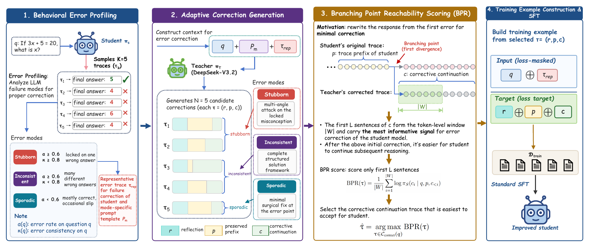

<div align="center">

<h2>FPRT: Failure Profiling and Reachable Trajectory Selection<br>for Reasoning Distillation</h2>

<p>
  <a href="https://github.com/visresearch/FPRT"></a>
  <a href="#requirements"></a>
  <a href="#requirements"></a>
</p>

<p>
Yijun Zhu<sup>1</sup> &nbsp;&nbsp;
Jianxin Wang<sup>1</sup> &nbsp;&nbsp;
Chengchao Shen<sup>1, ✉</sup>
</p>

<p><sup>1</sup>School of Computer Science and Engineering, Central South University</p>
<p><sup>✉</sup>Corresponding author</p>



</div>


<a id="requirements"></a>

## ⚙️ Installation

Requires Python 3.10+, PyTorch 2.4+, Transformers 4.51–4.x, CUDA, vLLM for sampling, and LLaMA-Factory for training. Install vLLM and LLaMA-Factory in compatible environments separately.

```bash
git clone https://github.com/visresearch/FPRT.git
cd FPRT
pip install -e '.[scoring]'
```

## 🛠️ Configuration

Fill in [scripts/env.example.sh](scripts/env.example.sh), then load it and set your run parameters. Replace all placeholders before running:

```bash
source scripts/env.example.sh
export MY_API_KEY="<api_key>"
export PRESET="<preset>"
export TRAIN_GPUS="<gpu_count>"
export LEARNING_RATE="<learning_rate>"
export EPOCHS="<epochs>"
```

| Variables | Purpose |
| --- | --- |
| `FPRT_ROOT`, `INPUT_DATASET` | Project directory and input data file |
| `STUDENT_MODEL`, `STUDENT_BASE_URL` | Original student checkpoint and sampling endpoint |
| `MY_API_BASE`, `MY_API_KEY`, `TEACHER_MODEL` | Teacher API endpoint, credentials, and model identifier |
| `RUN_DIR`, `TRAIN_OUTPUT` | Construction and training output directories |
| `TRAIN_GPUS` | Training GPU count |
| `PRESET` | Configuration name matching `configs/<preset>.json` |
| `LEARNING_RATE`, `EPOCHS` | Training learning rate and epoch count |

Use the same original student checkpoint for sampling, BPR, and SFT initialization.

Before training, create `configs/<preset>.json` for your model. Set `PRESET` to the filename without `.json`. Replace numeric placeholders, including their quotes, with JSON numbers:

```json
{
  "model_name_or_path": "<student_model_path>",
  "learning_rate": "<learning_rate>",
  "num_train_epochs": "<epochs>",
  "template": "<chat_template>"
}
```

## 📦 Data Construction

Input accepts JSONL records or a JSON array with `query` and `response` fields:

```json
{"query": "<question>", "response": "<reference solution with final answer>"}
```

Start the student server in a GPU session with vLLM installed:

```bash
bash scripts/serve_student.sh
```

In another terminal with the environment variables loaded, run sampling and teacher generation:

```bash
bash scripts/build_one_pass.sh --stage local
bash scripts/build_one_pass.sh --stage teacher
```

Release the student server's GPU allocation before running selection and formatting on the same GPU:

```bash
bash scripts/select_and_format.sh
```

The training data is saved to `$RUN_DIR/sft.jsonl` with `instruction` and `response` fields. This package constructs one pass. Add `--limit "<instance_limit>"` for a smaller run with real API calls. Repeating the command resumes completed instances; use a new `RUN_DIR` when changing inputs or generation settings.

## 🚀 Training

Activate your LLaMA-Factory environment and set `TRAIN_GPUS`. Inspect the configuration first:

```bash
python -m fprt.train --preset "$PRESET" --model "$STUDENT_MODEL" \
  --data "<training_data_path>" --output "$TRAIN_OUTPUT" \
  --gpus "$TRAIN_GPUS" --learning-rate "$LEARNING_RATE" --epochs "$EPOCHS" \
  --effective-batch "<effective_batch_size>" --seed "<seed>" --dry-run
```

Remove `--dry-run` to start training. Set `<training_data_path>` to your prepared or downloaded JSONL file; the launcher registers the `instruction`/`response` columns automatically.

The launcher uses full-parameter SFT with target-only loss. Configure your run through the preset and command-line options.

For Slurm, fill in the empty resource values in [scripts/train.slurm](scripts/train.slurm), activate the training environment, and submit:

```bash
sbatch scripts/train.slurm
```

The launcher supports one node. Slurm GPU count is read from `SLURM_GPUS_ON_NODE` unless `TRAIN_GPUS` is set.

## 📊 Results

The manuscript reports the following accuracies (%) for the 88.90K setting. Values are means with sample standard deviations across three SFT seeds.

| Student | GSM8K | MATH | SVAMP | ASDiv | MAWPS | Avg. |
| --- | --- | --- | --- | --- | --- | --- |
| Llama-3.1-8B-Instruct | 86.2 ± 0.4 | 46.2 ± 0.5 | 86.8 ± 0.2 | 86.1 ± 0.3 | 93.3 ± 0.4 | 79.7 ± 0.4 |
| DeepSeek-Math-7B-Instruct | 84.0 ± 0.2 | 48.9 ± 0.3 | 85.4 ± 0.2 | 89.8 ± 0.4 | 94.7 ± 0.3 | 80.6 ± 0.3 |

### Model Weights and Training Data

Model weights and training datasets are available on Hugging Face.

| Model | Model weights | Training data |
| --- | --- | --- |
| Llama-3.1-8B-Instruct-FPRT | [Weights](https://huggingface.co/visresearch/Llama-3.1-8B-Instruct-FPRT) | [data](https://huggingface.co/datasets/visresearch/FPRT_ll) |
| DeepSeek-Math-7B-Instruct-FPRT | [Weights](https://huggingface.co/visresearch/deepseek-math-7b-instruct-FPRT) | [data](https://huggingface.co/datasets/visresearch/FPRT_dp) |


## 📝 Citation

If you use this work, please cite:

```bibtex
@misc{zhu2026fprt,
  title={Failure Profiling and Reachable Trajectory Selection for Reasoning Distillation},
  author={Zhu, Yijun and Wang, Jianxin and Shen, Chengchao},
  year={2026}
}
```
